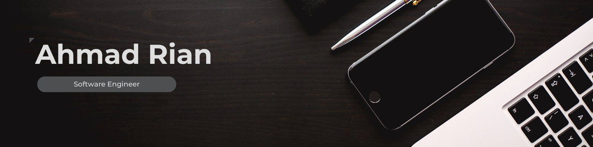

#  Hi, I'm Rian! 👋

💻 Software Engineer / Fullstack Developer, 2+ years of experience 
🏢 Running my own dev shop (Techworksnesia / Jenderal Software) 
🎓 Informatics graduate from Universitas Jenderal Soedirman, Indonesia 🇮🇩 
🚀 Building the **Presisi Academy** platform (LMS + CBT) and **Arah Photobox** 
✅ Shipped **Knalpot Apps** and **mariicup.com** 
🎾 Also run **Momentum Padel Series**, an event organizing brand for padel tournaments 
🛠️ Stack: Laravel, React, Next.js, Vue/Nuxt, Golang/Gin, Python (data/ML), PostgreSQL, Docker 
📫 Open to freelance, contract, and full-time opportunities

## 🌐 Socials:
  

🌐 Portfolio: https://ahmadrian.my.id/

## 💻 Tech Stack

**Languages & Core**
     

**Frontend**
    

**Backend & Framework**
   

**Database & Infra**
    

**Tools**
   

## 📊 GitHub Stats

## 📈 Contribution Activity

<picture>
  <source media="(prefers-color-scheme: dark)" srcset="https://raw.githubusercontent.com/ahmad-rian/ahmad-rian/output/github-contribution-grid-snake-dark.svg" />
  <source media="(prefers-color-scheme: light)" srcset="https://raw.githubusercontent.com/ahmad-rian/ahmad-rian/output/github-contribution-grid-snake.svg" />
  
</picture>

## 🧰 Skills

## 🚧 Currently Building

| Project | Description |
|---|---|
| **[Presisi Academy](https://presisiacademy.id)** | Company profile & CMS for OSN coaching, Next.js 16 + Go/Gin + PostgreSQL |
| **LMS Presisi** | Learning management system with a single Presisi Account (Keycloak SSO), Go + Next.js |
| **PENA CBT** | Computer-based test platform for Presisi Academy, synced with the LMS |
| **Arah Photobox** | Self-service photobooth: Laravel 13 + Inertia/React admin & guest gallery, Electron booth app with Canon EDSDK |

## ✅ Recently Shipped

| Project | Description |
|---|---|
| **Knalpot Apps** | E-commerce platform for aftermarket exhaust products, Go + React + Next.js monorepo with RajaOngkir & DOKU integration |
| **[mariicup.com](https://mariicup.com)** | Tournament management platform for padel events |
| **Momentum Padel Series** | Multi-tenant padel tournament platform: registration, brackets, real-time live score, plus a standalone [referee scoring & TV scoreboard](https://scoring-momentum.vercel.app) app |
| **Kothak Photobox** | Self-service photobooth: Laravel admin & guest gallery, Electron booth app, DOKU payment and Google Drive upload |
| **Tyas Studio** | Photo studio workflow: Windows desktop app tethered to Canon cameras (EDSDK, RAW capture, live view) with automatic upload to Google Drive |
| **Absensi Sekolah** | School attendance system: card scans, prayer attendance, leave requests, parent notifications and a super-admin attendance monitor |

---

